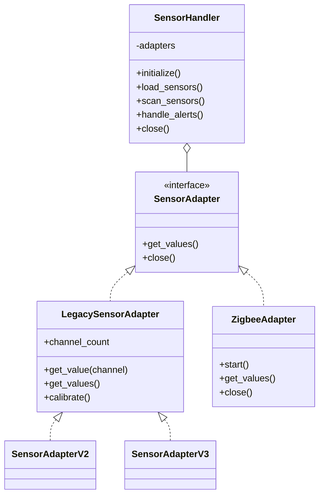
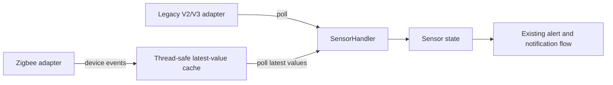

# Sensor Adapter Source Design

## Goal

Support both existing wired sensor boards and a Sonoff MG21 Zigbee dongle in the same monitor process.

- V2: GPIO digital inputs
- V3: MCP3008 ADC inputs over SPI
- Zigbee: event-driven device updates exposed as latest cached values

Existing V2/V3 adapters remain unchanged.

## Current Implementation

- [sensor_base.py](src/monitor/adapters/sensor_base.py) defines the legacy channel interface.
- [sensor.py](src/monitor/adapters/sensor.py) selects V2 or V3 using `BOARD_VERSION`.
- [sensor_v2.py](src/monitor/adapters/sensor_v2.py) reads GPIO inputs.
- [sensor_v3.py](src/monitor/adapters/sensor_v3.py) reads MCP3008 channels.
- [handler.py](src/monitor/sensor/handler.py) loads sensors, polls values, and applies alert logic.

## Proposed Design

`SensorHandler` owns multiple sensor adapters. The existing adapter is selected by board version; Zigbee is selected independently by configuration.



## Runtime Flow



The Zigbee adapter receives device events internally, updates a thread-safe cache, and returns the latest normalized readings when `SensorHandler` polls it. A reading should include:

```python
SensorReading(
    sensor_id=123,
    value=True,
    timestamp=..., 
    available=True,
    battery_level=87,
)
```

## Handler Rules

- Poll all configured adapters at the existing monitor rate, approximately 20 Hz.
- Apply the same state, sensitivity, arm/zone, and alert logic to every reading.
- Use `channel` only for V2/V3 sensors.
- Identify Zigbee readings by configured device identity, endpoint, and capability.
- Keep Zigbee `available` and `last_seen` separate from the alarm value.
- Keep ADC calibration and legacy channel validation only on the V2/V3 adapter.

## Adapter Selection

```text
get_sensor_adapter() -> V2 or V3 legacy adapter
get_zigbee_adapter() -> Zigbee adapter when enabled
SensorHandler.adapters = [legacy_adapter, zigbee_adapter]
```

The Zigbee adapter must not replace the current factory. Both adapters can operate simultaneously on a V2 or V3 installation.
