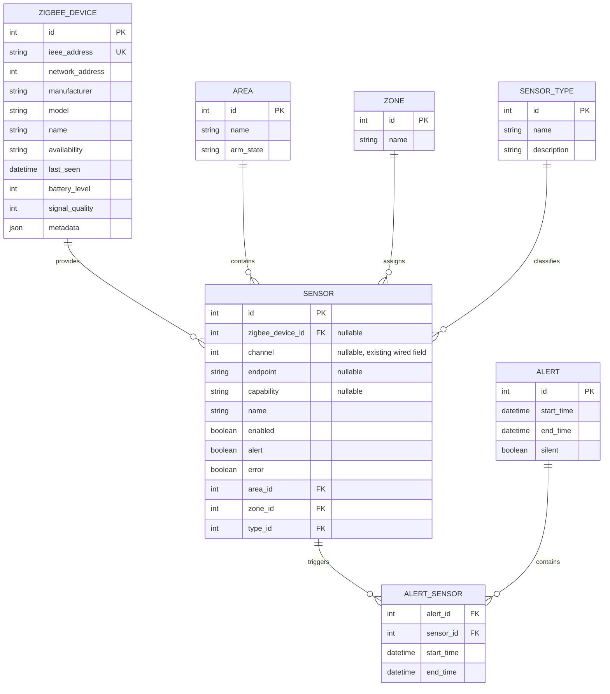
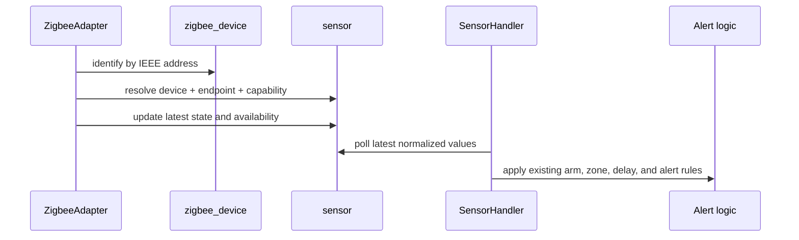

# Sensor Data Design

## Goal

Store existing wired sensors and Zigbee sensors in the same alarm system without changing the meaning of the existing wired `channel` field.

## Coordinator Configuration

There is one Zigbee coordinator, so store its configuration in the existing `option` table using a dedicated option such as `zigbee`.

```json
{
  "enabled": true,
  "serial_port": "/dev/serial/by-id/sonoff-dongle",
  "adapter": "sonoff_mg21",
  "permit_join": false
}
```

This follows the current `Option` and `BaseConfig` configuration pattern. Paired device data does not belong in options.

## Database Tables



## Sensor Mapping

`SENSOR` is the logical sensor used by the monitor and alert system.

| Source | `channel` | `zigbee_device_id` | `endpoint` / `capability` |
|---|---:|---:|---|
| Wired V2/V3 | required | null | null |
| Zigbee | null | required | required |

Examples:

```text
Wired sensor:
  channel = 3
  zigbee_device_id = NULL

Zigbee contact sensor:
  channel = NULL
  zigbee_device_id = 12
  endpoint = "1"
  capability = "contact"
```

A single Zigbee device may provide multiple logical sensors, for example `contact`, `tamper`, and `temperature`. Each capability gets its own `SENSOR` row and can have its own name, zone, area, and alert settings.

## Runtime Mapping



The Zigbee adapter owns device identity and latest-value updates. `SensorHandler` consumes normalized sensor values just like wired readings. Existing `channel` validation and ADC calibration apply only to wired sensors.

## Recommended Constraints

- `zigbee_device.ieee_address` is unique.
- A Zigbee sensor requires `zigbee_device_id`, `endpoint`, and `capability`.
- A wired sensor requires `channel` and has no Zigbee device link.
- `channel` remains nullable because Zigbee sensors do not use hardware channels.
- `last_seen` and `availability` are separate from the alarm `alert` state.
